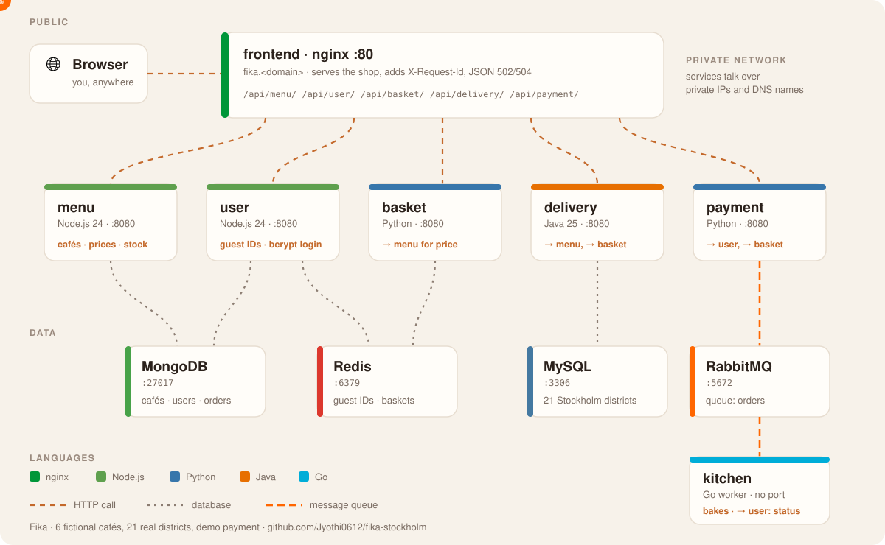

# Fika · order from Stockholm cafés

A demo microservices app, built to be **deployed by hand, one server at a time**: order kanelbullar and coffee from Stockholm cafés, for pickup or bike delivery across the city.

11 servers, 4 languages, 4 data stores. Cafés are fictional; districts are real Stockholm areas; payment is a demo (no real money).

| Server | What it does | Language | Talks to |
|---|---|---|---|
| frontend | serves the web shop, routes `/api/<service>/` | nginx | all 5 services |
| menu | cafés and items | Node.js 24 | MongoDB |
| user | guest IDs, accounts (bcrypt), order history | Node.js 24 | MongoDB, Redis |
| basket | the basket; checks price and stock with menu | Python 3.14 (Flask + gunicorn) | Redis, menu |
| delivery | pickup or bike delivery: distance, minutes, fee | Java 25 + Maven (Spring Boot) | MySQL, menu, basket |
| payment | demo mobile pay; queues the order, saves history, empties the basket | Python 3.14 | user, basket, RabbitMQ |
| kitchen | "bakes" each paid order; no port, reads the queue | Go | RabbitMQ |
| mongodb · redis · mysql · rabbitmq | the data stores | | |

## Deploy it (RHEL 9 practice AMI, t3.micro is enough)

Build in this order; each guide is self-contained:

1. [01-mongodb](docs/01-mongodb.md) · [02-redis](docs/02-redis.md) · [03-mysql](docs/03-mysql.md) · [04-rabbitmq](docs/04-rabbitmq.md)
2. [05-menu](docs/05-menu.md) · [06-user](docs/06-user.md) · [07-basket](docs/07-basket.md) · [08-delivery](docs/08-delivery.md) · [09-payment](docs/09-payment.md) · [10-kitchen](docs/10-kitchen.md)
3. [11-frontend](docs/11-frontend.md)

### DNS (Route 53, one hosted zone)

The guides use `fika.agenticengg.online`; use your own domain. Internal names point to **private** IPs, so they keep working when an instance is stopped and started.

| Record | Type | Value |
|---|---|---|
| `fika.<domain>` | A | frontend **public** IP |
| `menu.fika.<domain>`, `user.…`, `basket.…`, `delivery.…`, `payment.…` | A | that server's **private** IP |
| `mongodb.fika.<domain>`, `redis.…`, `mysql.…`, `rabbitmq.…` | A | that server's **private** IP |

Use a low TTL (60 s) while you build. A stopped and started instance gets a **new public IP**: update the `fika.<domain>` record (or use an Elastic IP).

### Security groups

One group per server, named project-component. Allow SSH (22) from your IP on all of them.

| Group | Inbound | From |
|---|---|---|
| fika-frontend | 80 | 0.0.0.0/0 |
| fika-menu | 8080 | fika-frontend, fika-basket, fika-delivery |
| fika-user | 8080 | fika-frontend, fika-payment |
| fika-basket | 8080 | fika-frontend, fika-delivery, fika-payment |
| fika-delivery | 8080 | fika-frontend |
| fika-payment | 8080 | fika-frontend |
| fika-kitchen | none | (it only connects out) |
| fika-mongodb | 27017 | fika-menu, fika-user |
| fika-redis | 6379 | fika-user, fika-basket |
| fika-mysql | 3306 | fika-delivery |
| fika-rabbitmq | 5672 | fika-payment, fika-kitchen |

## Downloads

Every guide downloads its code from the latest release:
`https://github.com/Jyothi0612/fika-stockholm/releases/latest/download/<name>.tar.gz`
(`menu`, `user`, `basket`, `delivery`, `payment`, `kitchen`, `frontend`, `mysql-data`).

## When it doesn't work

1. Open `http://fika.<domain>/status`: every service's health check, live.
2. Read the exact error. `timed out` = network: security group or wrong IP. `refused` = reached the server, nothing listening on that port. A JSON `{"message":"… from nginx"}` = nginx could not reach the service.
3. On the failing server: `systemctl status <service>`, `ss -lntp`, `curl localhost:8080/health`, `journalctl -u <service> -n 50`.
4. Changed a service file? `systemctl daemon-reload && systemctl restart <service>`.

## Run it on a laptop (testing only)

`local/up.sh` starts all 11 parts with Docker Compose on http://localhost:8090.

---
The services were written with Claude Code; the point of this repo is the deployment, done by hand.
